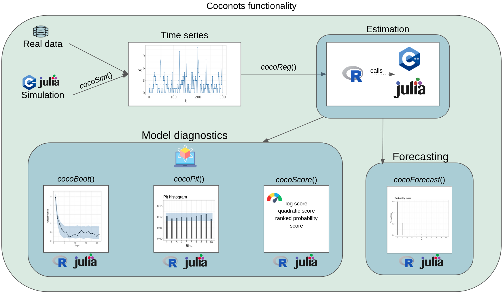
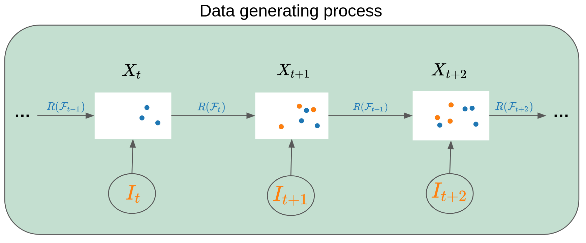
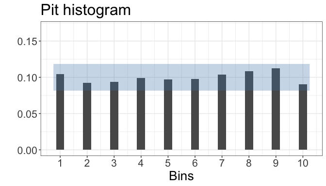
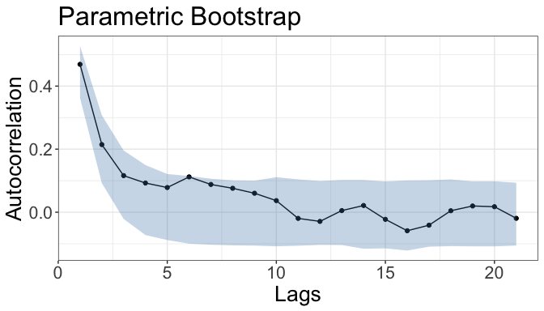
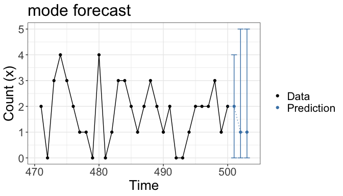
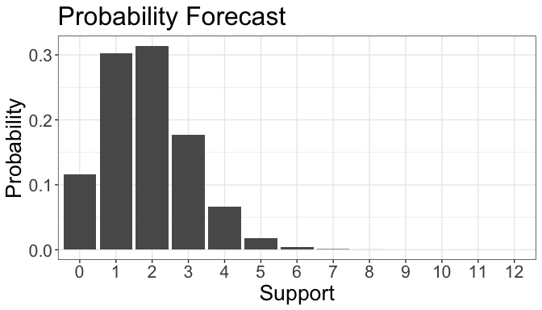
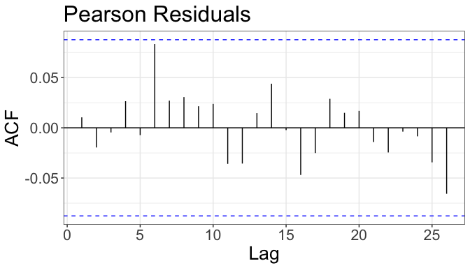

<!-- README.md is generated from README.Rmd. Please edit that file -->

# coconots

<!-- badges: start -->
[](https://github.com/manuhuth/coconots/actions/workflows/R-CMD-check.yaml)
[](https://github.com/manuhuth/coconots/actions/workflows/julia-tests.yaml)
[](https://github.com/manuhuth/coconots/actions/workflows/pkgdown.yaml)
[](https://CRAN.R-project.org/package=coconots)
[](https://app.codecov.io/gh/manuhuth/coconots?branch=main)
<!-- badges: end -->

📖 **Documentation:** <https://manuhuth.github.io/coconots/>

Functions to analyse time series consisting of low counts are provided.
The focus in the current version is on practical models that can capture
first and higher-order dependence based on the work of Joe (1996). Both
equidispersed and overdispersed marginal distributions of data can be
modelled. Regression effects can be included. Fast and efficient
procedures for likelihood based inference and probabilistic forecasting
are provided as well as useful tools for model validation and
diagnostics.



## Details

`cocoSim()` simulates convolution-closed count time series models and
`cocoReg()` fits them. The S3 method `predict()` computes k-step ahead
forecasting distributions for a fitted model. `cocoBoot()`, `cocoPit()`,
`cocoScore()`, `cocoSoc()` and `cocoResid()` provide routines for model
assessment. The main usage of the package is illustrated in the help
page of `cocoReg()`. Further examples are given in the help pages of the
other functions.

By default, the functions use a C++ implementation via Rcpp. Users with
a Julia installation can instead run them in Julia by setting the
argument `julia = TRUE`. This is most useful for `cocoReg()`, where the
likelihood is evaluated numerically: the Julia backend uses automatic
differentiation to obtain exact gradients, which can improve numerical
stability and speed of convergence for complex models.

Both backends gave qualitatively similar results in our tests. Rcpp is
therefore the default, so that the package works without Julia.

## Model



## Installation

The stable version of coconots is available from
[CRAN](https://cran.r-project.org/package=coconots):

``` r
install.packages("coconots")
```

The development version can be installed from GitHub:

``` r
devtools::install_github("manuhuth/coconots")
```

## Example using the Rcpp implementation

The Rcpp implementation is the default. The regression results can be
summarized using the `summary()` function.

``` r
library(coconots)
length <- 500

pars <- c(1, 0.4, 0.2)
set.seed(12345)
data <- cocoSim(order = 1, type = "GP", par = pars,
                length = length)
coco <- cocoReg(order = 1, type = "GP", data = data)
summary(coco)
#> Coefficients:
#>          Estimate   Std..Error         t
#> lambda     1.0546       0.0930   11.3368
#> alpha      0.4202       0.0373   11.2541
#> eta        0.1609       0.0329    4.8961
#> 
#> Type: GP
#> Order: 1
#> 
#> Log-likelihood: -885.012
#> AIC: 1776.024
#> BIC: 1788.6679
```

## Example using the Julia implementation

The Julia functions require a working Julia installation.
`installJuliaPackages()` installs the Julia package Coconots.jl (version
0.2.0 or higher) and updates an older installed version. It needs to be
run once.

``` r
coconots::installJuliaPackages()
#> Starting Julia ...
```

The Julia implementation is used by setting the argument `julia = TRUE`.
The seed of the Julia random number generator is set via `julia_seed`,
since `set.seed()` does not affect Julia.

``` r
library(coconots)
length <- 500

pars <- c(1, 0.3, 0.01, 0.2)
data <- cocoSim(order = 2, type = "Poisson", par = pars, length = length,
                julia = TRUE, julia_seed = 123)
coco <- cocoReg(order = 2, type = "Poisson", data = data, julia = TRUE)
```

## Model assessment

The package provides several tools for model assessment. A model fitted
with the Rcpp implementation can also be assessed with the Julia
implementation. For this, the fit must be created with
`julia_installed = TRUE`, which stores a Julia-compatible copy of the
fit. This is not necessary if the model was fitted with `julia = TRUE`.

``` r
library(coconots)
length <- 500

pars <- c(1, 0.4)
set.seed(12345)
data <- cocoSim(order = 1, type = "Poisson", par = pars, length = length)
coco <- cocoReg(order = 1, type = "Poisson", data = data,
                julia_installed=TRUE)
(scores <- cocoScore(coco, julia = TRUE))
#> $log.score
#> [1] 1.501935
#> 
#> $quad.score
#> [1] -0.2532048
#> 
#> $rps.score
#> [1] 0.6197608
#> 
#> $aic
#> [1] 1502.931
#> 
#> $bic
#> [1] 1511.36
pit <- cocoPit(coco, julia = TRUE)
plot(pit)
#> Warning: `aes_string()` was deprecated in ggplot2 3.0.0.
#> ℹ Please use tidy evaluation idioms with `aes()`.
#> ℹ See also `vignette("ggplot2-in-packages")` for more information.
#> ℹ The deprecated feature was likely used in the coconots package.
#>   Please report the issue at <https://github.com/manuhuth/coconots/issues>.
#> This warning is displayed once per session.
#> Call `lifecycle::last_lifecycle_warnings()` to see where this warning was
#> generated.
```



``` r
boot <- cocoBoot(coco, julia = TRUE)
plot(boot)
```



``` r
forecast <- predict(coco, k=3, julia = TRUE)
plot(forecast) #plot all k forecasts
```



``` r
plot(forecast[[1]]) #plot density of one-step ahead forecast
```



``` r
resid <- cocoResid(coco)
plot(resid)
```



## Compare models

`cocoSoc()` fits the Poisson and generalized Poisson models of order 1
and 2 to the same data and tabulates the scoring rules for model
selection.

``` r
library(coconots)
length <- 500

pars <- c(1.3, 0.25, 0.03, 0.2, 0.3)
set.seed(12345)
data <- cocoSim(order = 2, type = "GP", par = pars, length = length)
soc <- cocoSoc(data, julia = TRUE)
#> [1] "Computing PAR1 model."
#> [1] "Computing PAR2 model."
#> [1] "Computing GP1 model."
#> [1] "Computing GP2 model."
summary(soc)
#>            Logarithmic Score   Quadratic Score   Ranked Probability Score
#> 1   PAR1            2.265970        -0.1221436                   1.302572
#> 2   PAR2            2.264753        -0.1223451                   1.301770
#> 3    GP1            2.164318        -0.1363304                   1.263041
#> 4    GP2            2.161843        -0.1364925                   1.261362
```
